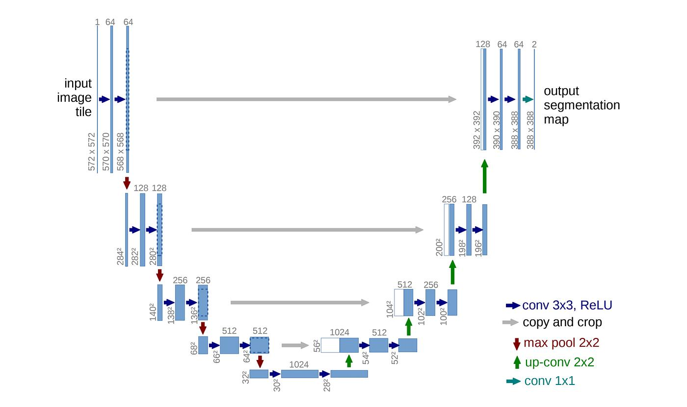

# U-Net LiTS Liver & Tumor Segmentation

PyTorch U-Net 구현 코드를 공부하고, **LiTS(Liver Tumor Segmentation) CT 데이터셋**에 맞게 수정해 간·종양 분할을 실습한 **학습용 저장소**입니다.

Oxford-IIIT Pet 이진 분할용으로 작성된 [RohanSardar/U-Net](https://github.com/RohanSardar/U-Net) 코드를 참조해, 3D CT를 2D slice로 학습하는 3-class(배경 / 간 / 종양) 분할로 변경했습니다. 그 위에 loss와 CT 전처리 비교 실험을 진행했습니다.

> 성능 최적화보다 **분할 파이프라인의 동작 원리를 이해하는 것**이 목적입니다. 데이터 일부(volume 11개)만 사용했고, 결과는 단일 seed·1회 실행 기준입니다.

---

## U-Net Architecture

<p align="center">
  
</p>
<p align="center"><sub>Figure: U-Net architecture (Ronneberger et al., 2015)</sub></p>

U-Net은 Ronneberger et al.(2015)이 제안한 Fully Convolutional Network 기반의 의료영상 Semantic Segmentation 모델입니다.

기존 Sliding-window 방식에서 발생하는 중복 연산과, Context 확보와 Localization Accuracy 사이의 Trade-off를 개선하기 위해 **Encoder-Decoder 구조와 Skip Connection**을 결합했습니다.

### 1. Contracting Path (Encoder)

Encoder는 입력 영상에서 특징을 추출하고 Downsampling을 통해 넓은 영역의 Context Information을 학습합니다.

- **Double Convolution**: 3×3 Convolution(Padding 없음)과 ReLU를 두 번 반복
- **Max Pooling**: 2×2 Max Pooling (Stride 2)을 이용해 Spatial Resolution을 절반으로 감소
- **Channel Expansion**: Downsampling 단계마다 Feature Channel 수를 2배로 증가 (64 → 1024)
- **Bottleneck**: 가장 낮은 Spatial Resolution에서 고수준의 Context Information 학습

### 2. Expanding Path (Decoder)

Decoder는 Encoder에서 추출한 특징을 활용해 Spatial Resolution을 복원하고 Pixel 단위의 Segmentation을 수행합니다.

- **Upsampling**: 2×2 Up-convolution으로 Spatial Resolution을 2배로 늘리고 Channel 수를 절반으로 감소
- **Skip Connection**: Encoder의 고해상도 Feature Map을 Decoder로 전달
- **Concatenation**: Encoder의 Spatial Information과 Decoder의 Context Information을 Channel 방향으로 결합
- **Double Convolution**: 결합된 Feature Map에서 특징을 재추출
- **Output Layer**: 1×1 Convolution으로 Pixel별 Class Score 출력

Skip Connection은 Downsampling 과정에서 손실될 수 있는 세부 위치 정보를 보완하여 정밀한 Localization을 가능하게 합니다.

### 3. Valid Convolution & Overlap-tile Strategy

원본 U-Net은 Padding을 사용하지 않는 Valid Convolution을 적용합니다.

따라서 Convolution을 거칠수록 Feature Map의 Spatial Size가 감소하며, 원본 논문의 대표적인 구조에서는 **572×572 입력에 대해 388×388 크기의 출력**을 생성합니다. Encoder와 Decoder의 Feature Map 크기가 달라지므로, Skip Connection 시 Encoder의 Feature Map을 **Crop**하여 크기를 맞춘 뒤 결합합니다.

이러한 구조에서 입력 영상의 주변 영역은 중앙부를 예측하기 위한 Context로 활용됩니다.

큰 의료영상을 제한된 GPU Memory에서 처리하기 위해 Overlap-tile Strategy를 사용합니다.

- 입력 영상을 서로 겹치는 Tile로 분할
- 각 Tile의 중앙 영역을 예측
- Tile별 출력을 결합하여 전체 Segmentation Map 생성
- 영상 경계에서 부족한 Context는 Mirroring으로 보완

### 4. Training Strategy in the Original Paper

원본 U-Net 논문은 적은 수의 Annotation으로 효과적인 학습을 수행하기 위해 다음 기법을 활용합니다.

- **Elastic Deformation**: 조직의 다양한 형태 변화를 모사하여 Data Augmentation 수행
- **Weighted Loss**: Pixel별 Weight Map으로 Class 빈도 차이를 보정하고, 서로 인접한 세포 사이의 경계를 강조하여 분리 성능 개선

이러한 학습 전략은 제한된 의료영상 데이터에서도 모델의 일반화 성능을 높이기 위한 목적으로 제안되었습니다.

### 5. Application to LiTS Segmentation

본 프로젝트에서는 기존 PyTorch U-Net 구현을 기반으로 LiTS CT 데이터셋에 맞게 분할 파이프라인을 수정했습니다.

- **Input**: 1-channel CT axial slice (512×512 → 256×256 Resize)
- **Output**: 3-class segmentation (Background / Liver / Tumor)
- **Architecture**: 기존 `model.py`의 U-Net 구조 유지
- **Preprocessing**: HU Windowing 및 정규화
- **Loss**: CrossEntropy, Soft Dice, CE + Dice 비교
- **Evaluation**: Liver / Tumor Global Dice 및 IoU

참조한 구현(`model.py`)은 원본 논문 구조와 다음이 다릅니다.

| 항목 | 원본 논문 | 본 프로젝트 구현 |
|---|---|---|
| Convolution | Valid (Padding 0) → 출력이 입력보다 작음 | **Same (Padding 1)** → 입력과 출력 크기가 같음 |
| Skip Connection | Crop 후 Concatenation | 크기가 같아 **Crop 없이** Concatenation |
| Normalization | 없음 | Convolution 뒤 **BatchNorm** 추가 |
| 입력 처리 | Overlap-tile | Slice 전체를 Resize하여 한 번에 입력 |

원본 논문의 구조적 특징과 실제 사용한 모델 구현은 구분해야 합니다. 특히 Valid Convolution, Feature Map Cropping, Overlap-tile Strategy, Elastic Deformation 및 Weighted Loss는 원본 논문에서 제안한 방법이며, 본 프로젝트에서 모두 구현하거나 적용한 것은 아닙니다.

본 실습의 목적은 U-Net 기반 의료영상 분할 파이프라인을 이해하고, CT 전처리와 Loss Function 선택이 간·종양 분할 결과에 미치는 영향을 분석하는 것입니다.

---

## 원본 코드에서 변경한 내용

| 항목 | 원본 (Oxford Pet) | 이 저장소 (LiTS) |
|---|---|---|
| 데이터 | 2D RGB 사진 (jpg/png) | 3D CT Volume (NIfTI) → **axial 2D slice** 추출 |
| 입력 채널 | 3 (RGB) | **1** (CT) |
| 출력 채널 | 1 (Binary) | **3** (Background / Liver / Tumor) |
| 정규화 | ImageNet mean/std | **HU Windowing** [−100, 200] → 0~1 |
| Resize | Image / Mask | CT: Bilinear, Mask: **Nearest** (Class 번호 보존) |
| GT Mask 형식 | `(B, 1, H, W)` float | `(B, H, W)` long |
| Loss | BCEWithLogits | **CrossEntropy** (+ Dice / CE+Dice 선택) |
| 예측 | Sigmoid > 0.5 | **Argmax** |
| 지표 | Batch별 Binary Dice 평균 | 간·종양 **Global Dice / IoU** |
| 데이터 분할 | 이미지 단위 `random_split` | **Volume(환자) 단위** 분할 (Data Leakage 방지) |
| Best Checkpoint 기준 | Val Dice | **0.3 × Liver Dice + 0.7 × Tumor Dice** |

`model.py`(U-Net 구조)는 수정하지 않고, 생성 시 `UNet(in_channels=1, out_channels=3)`으로만 바꿨습니다.

## 추가한 작업

- **Slice index 관리**: `(volume_id, slice_idx)` 단위로 관리하고, 간이 있는 slice만 사용 (5,277장 중 1,688장)
- **Global Dice**: batch별 Dice 평균 대신 epoch 전체의 교집합과 (예측 + 정답)을 누적해 한 번에 계산 → 종양이 없는 batch에서 Dice = 1로 과대평가되는 문제 방지
- **Loss 선택**: `--loss ce | dice | ce_dice` (Soft Dice Loss, CE + Dice Loss 직접 구현)
- **CT 전처리 선택**: `--norm window | minmax`, `--w_min`, `--w_max`
- **실험 관리**: seed 고정, 실험별 폴더(`checkpoints/<exp_name>/`)에 `best_model.pth`, `history.csv`(epoch별 기록), `args.json`(실험 설정) 저장
- **평가 자동화**: `evaluate.py`가 `args.json`을 읽어 학습 때와 같은 전처리로 test 평가
- **분석 노트북** (`base.ipynb`): NIfTI 구조 분석, HU 분포, windowing 비교, slice 추출, loss 테스트, CT / GT / Prediction 시각화

---

## 폴더 구조

```
.
├── model.py          U-Net (DoubleConv, Encoder-Decoder, Skip Connection)
├── dataset.py        LiTS Dataset, HU windowing, volume 단위 DataLoader
├── train.py          학습 (loss / 전처리 선택, best checkpoint 저장)
├── evaluate.py       Test set 정량 평가 (Global Dice / IoU)
├── utils.py          Checkpoint I/O, Dice 통계, Dice Loss, CE+Dice Loss
├── base.ipynb        데이터 분석 및 결과 시각화
├── data/             LiTS 데이터 (직접 다운로드, git 제외)
│   ├── volume_pt1/
│   └── segmentations/
└── checkpoints/      학습 결과 (git 제외)
```

## 환경

실험에 사용한 환경입니다.

| 패키지 | 버전 |
|---|---|
| Python | 3.10.18 |
| PyTorch | 2.3.1 (CUDA 11.8) |
| nibabel | 5.4.2 |
| numpy | 1.26.4 |
| tqdm | 4.67.1 |
| matplotlib | 3.7.5 |

```bash
pip install torch==2.3.1 --index-url https://download.pytorch.org/whl/cu118
pip install nibabel==5.4.2 numpy==1.26.4 tqdm matplotlib
```

학습은 NVIDIA GeForce RTX 2080 Ti (11GB)에서 batch 4, 256×256 기준으로 진행했습니다.

## 데이터 준비

1. Kaggle의 [Liver Tumor Segmentation](https://www.kaggle.com/datasets/andrewmvd/liver-tumor-segmentation) 데이터셋에서 다운로드
2. `volume_pt1/`의 `volume-0.nii` ~ `volume-10.nii`를 `data/volume_pt1/`에 넣기
3. `segmentations/`의 `segmentation-0.nii` ~ `segmentation-10.nii`를 `data/segmentations/`에 넣기

번호가 같은 volume과 segmentation이 한 쌍입니다. 분할은 volume 0~7 (train) / 8~9 (val) / 10 (test)입니다.

## 실행

`data/`가 있는 위치에서 실행합니다.

```bash
# 학습
python train.py --loss ce_dice --epochs 20 --batch_size 4 --seed 42

# 전처리를 바꿔 학습 (실험 이름으로 저장 폴더 지정)
python train.py --loss ce_dice --norm minmax --exp_name ce_dice_minmax
python train.py --loss ce_dice --norm window --w_min -160 --w_max 240 --exp_name ce_dice_w160_240

# Test 평가 (학습 때 전처리를 args.json에서 자동으로 읽음)
python evaluate.py --exp_name ce_dice
```

---

## 실험 결과

공통 조건: 20 epoch, batch 4, Adam 1e-4, seed 42, 256×256 / Test: volume 10 (181 slices)

### Loss Function 비교 (HU [−100, 200])

| Loss | Liver Dice | Liver IoU | Tumor Dice | Tumor IoU |
|---|---|---|---|---|
| CE | **0.9738** | **0.9489** | 0.8524 | 0.7428 |
| Dice | 0.9669 | 0.9359 | **0.8780** | **0.7825** |
| CE + Dice | 0.9725 | 0.9464 | 0.8650 | 0.7621 |

- CE: 학습이 가장 안정적이고 간 분할 성능이 가장 높음
- Dice: 종양 분할 성능이 가장 높지만, epoch 14 이후 종양 예측이 붕괴함 (softmax 포화로 gradient 소실)
- CE + Dice: 초반 수렴이 가장 빠르고, 종양 성능과 안정성 사이에서 절충

### HU 전처리 비교 (CE + Dice)

| 전처리 | Liver Dice | Liver IoU | Tumor Dice | Tumor IoU |
|---|---|---|---|---|
| Min-Max (slice 단위) | 0.9604 | 0.9238 | 0.8467 | 0.7341 |
| HU [−100, 200] | **0.9725** | **0.9464** | 0.8650 | 0.7621 |
| HU [−160, 240] | 0.9692 | 0.9402 | **0.8898** | **0.8014** |

- Windowing을 하지 않으면(Min-Max) 관심 조직의 대비가 압축되어 성능과 학습 안정성이 모두 떨어짐
- 두 window 간 차이는 validation과 test에서 순위가 바뀔 정도로 작음 → window 범위보다 windowing 적용 여부가 중요

### 한계

- 단일 seed, 1회 실행 / volume 11개만 사용 (val 2명, test 1명)
- 20 epoch, 고정 learning rate
- 간이 있는 slice만 평가하여 간이 없는 slice의 오탐은 측정하지 않음

---

## 출처

- 논문: Ronneberger, O., Fischer, P., & Brox, T. (2015). *U-Net: Convolutional Networks for Biomedical Image Segmentation*. MICCAI 2015. [arXiv:1505.04597](https://arxiv.org/abs/1505.04597)
- 참조 코드: [RohanSardar/U-Net](https://github.com/RohanSardar/U-Net) — PyTorch U-Net 구현 (Oxford-IIIT Pet binary segmentation)
- 데이터셋: [Liver Tumor Segmentation (Kaggle)](https://www.kaggle.com/datasets/andrewmvd/liver-tumor-segmentation) — LiTS, CC BY-NC-SA (비상업적 용도)
